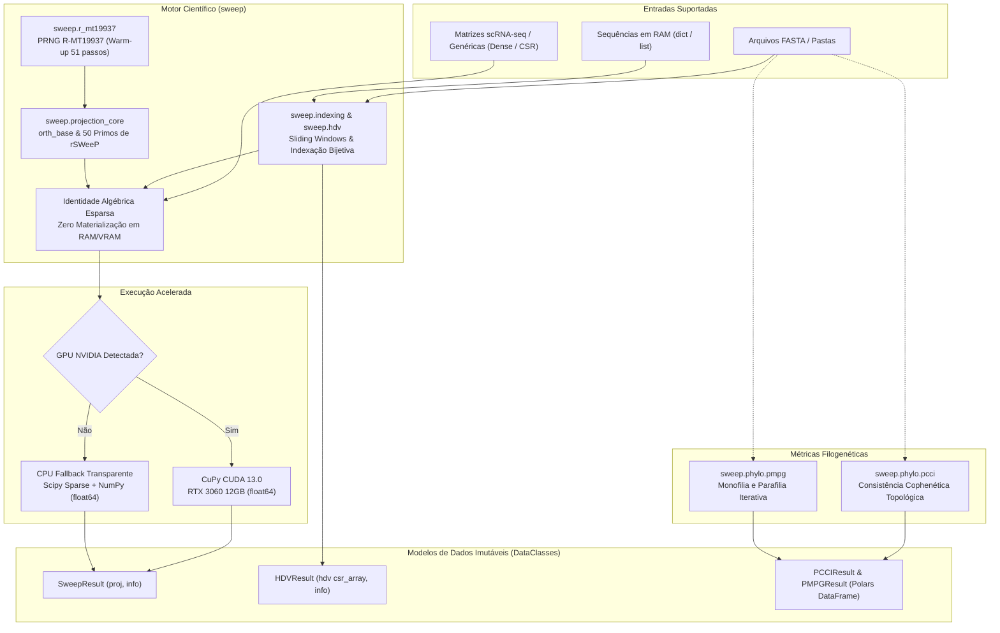

# 🏗️ Arquitetura, Rigor Matemático e Paridade SWeeP: `rSWeeP` (R) → `sweep` (Python)

> **Projeto:** Paridade Funcional e Rigor Matemático `rSWeeP` (R) → `sweep` (Python)  
> **Instituição:** PPGBioinfo / UFPR — Laboratório de Inteligência Artificial Aplicada à Bioinformática (AIBIA Lab)  
> **Status:** Spec-Anchored v2.2.0  

---

## 📐 Diagrama Arquitetural e Fluxo de Execução

---

## 🔬 Os 6 Invariantes Matemáticos Obrigatórios

1. **Base Quase-Ortonormal Determinística (`orth_base` / `sweep_lite`):**
   * Utiliza os **50 primeiros números primos** (`2..229`).
   * PRNG exato `R-MT19937`: `set.seed(seed)` executa **51 passos de warm-up** no LCG linear congruente $69069 \cdot s + 1 \pmod{2^{32}}$ antes de preencher o estado do `MT19937` e gerar $M_{\text{proj}}$ ($50 \times \text{col}$) em ordem column-major (`order="F"`).
   * Fórmula modular 1-based: $(j + 1) \bmod P_p$.

2. **Dupla Formulação Preservada:**
   * `orth_base()` e `sweep_lite()` usam os 50 primos do `rSWeeP` (v2.9).
   * `orthbase()` legado (SVD) e `get_default_proj_mat()` (SRB 2020) permanecem funcionais e testados para reprodução histórica com `@deprecated`.

3. **Indexação Bijetiva e Descarte Estrito de Janelas:**
   * $f(S_k) = 1 + \sum_{q=1}^m (V(S_q) - 1) \cdot K^{q-1}$.
   * Qualquer janela com resíduo fora de $[1, K]$ ou `*` em **posição ativa (`mask == 1`)** é descartada.
   * Caracteres especiais em posições neutras (`mask == 0`, *don't care*) preservam a janela.
   * Multi-FASTA concatenado com `spacer = "*" * len(mask)`.

4. **Tabela de Verdade dos 8 Modos e Zero-Materialização Esparsa:**
   * `bin=False, norm="logNeg"`: $x=0 \mapsto -1$, $x=1 \mapsto \log_{10}(1) = 0$, $x>1 \mapsto \log_{10}(x)$.
   * Identidade algébrica esparsa:
     $$\tilde{X} B = \hat{X}_{\text{sparse}} B - \mathbf{1}_N (\mathbf{1}_L^T B)$$
     onde entradas não nulas recebem $(\hat{X}_{\text{sparse}})_{k, i} = v_{k, i} + 1$ (para $x=1$, vale $+1$, cancelando exatamente o $-1$ do offset sem densificar zeros em RAM/VRAM).

5. **Precisão `np.float64` (IEEE 754):**
   * Todas as novas funções científicas operam em `float64` tanto em CPU quanto em GPU.

6. **Topologia Exata em Filogenia (`pcci` / `pmpg`):**
   * `pcci`: `edge.length = 1.0` (distância cofenética topológica), preservação da ordem de folhas e desempate decrescente de `binvec`.
   * `pmpg`: regra de enraizamento exata de `ape::is.monophyletic` (`reroot = !is.rooted(phy)` via outgroup) e poda iterativa `ape::drop.tip`.
